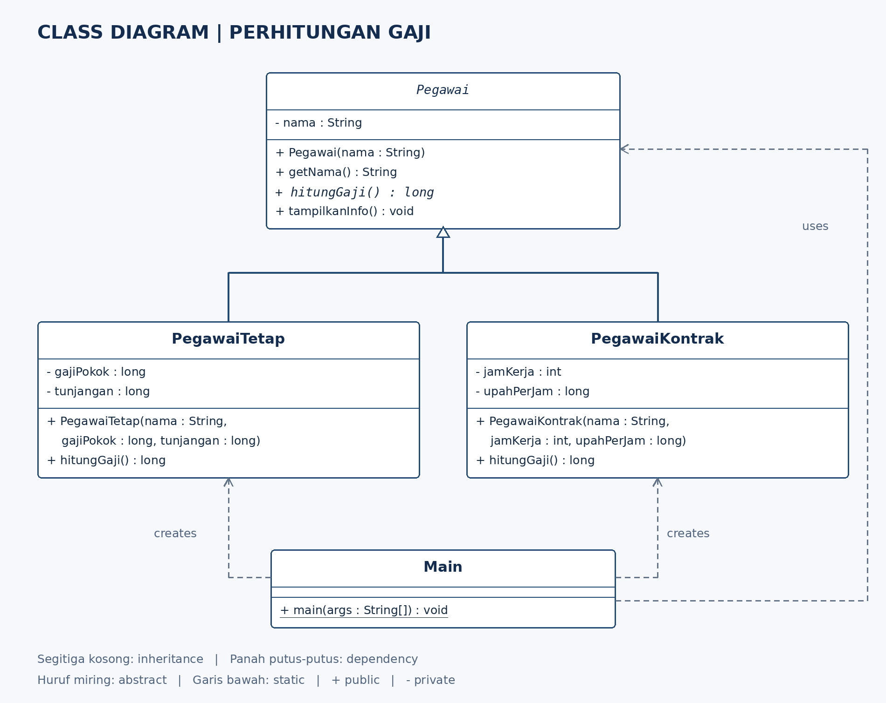

# Studi Kasus OOP: Perhitungan Gaji Pegawai

## Anggota kelompok
- Anggota 1: Topan Izazih NIM F1D02510135.
- Anggota 2: Juniardi Akbar NIM F1D02510062

## Permasalahan
Sebuah perusahaan memiliki pegawai tetap dan pegawai kontrak. Semua pegawai mempunyai nama, tetapi aturan perhitungan gajinya berbeda. Dalam contoh sederhana ini, gaji pegawai tetap adalah gaji pokok ditambah tunjangan, sedangkan gaji pegawai kontrak adalah jam kerja dikalikan upah per jam. Program menggunakan abstract class agar data dan perilaku umum dapat digunakan bersama, sementara rumus gaji ditentukan setiap subclass.

## Class diagram


Notasi: `+` public, `-` private. Nama class/method yang ditulis miring berarti abstract. Panah segitiga kosong menunjuk superclass; panah putus-putus menunjukkan dependency (penggunaan).

## Struktur kode
| File | Fungsi |
| --- | --- |
| src/Pegawai.java | Abstract superclass, menyimpan nama dan mendefinisikan hitungGaji(). |
| src/PegawaiTetap.java | Subclass untuk gaji pokok ditambah tunjangan. |
| src/PegawaiKontrak.java | Subclass untuk jam kerja dikalikan upah per jam. |
| src/Main.java | Membuat objek dan menjalankan demonstrasi polymorphism. |

## Penjelasan konsep yang diminta
### 1. Abstract class
`Pegawai` ditulis sebagai `public abstract class Pegawai`. Class ini menjadi dasar bagi jenis pegawai lain dan tidak dapat dibuat langsung dengan `new Pegawai(...)`. Class ini mempunyai constructor, atribut nama, method biasa getNama() dan tampilkanInfo(), serta abstract method hitungGaji().

### 2. Abstract method
`public abstract long hitungGaji();` hanya mendeklarasikan method tanpa isi. PegawaiTetap dan PegawaiKontrak, sebagai subclass konkret, wajib memberikan implementasinya.

### 3. Inheritance
`PegawaiTetap extends Pegawai` dan `PegawaiKontrak extends Pegawai` menunjukkan pewarisan. Kedua subclass dapat memakai getNama() dan tampilkanInfo() dari Pegawai. Atribut nama tetap private dan diakses melalui getNama(); constructor superclass dipanggil lewat super(nama). Constructor tidak diwariskan.

### 4. Method overriding
Kedua subclass menulis ulang hitungGaji() dengan signature yang sama dan anotasi @Override. PegawaiTetap mengembalikan gajiPokok + tunjangan, sedangkan PegawaiKontrak mengembalikan jamKerja * upahPerJam.

### 5. Polymorphism
Array `Pegawai[]` berisi objek PegawaiTetap dan PegawaiKontrak. Dalam perulangan, variabel `pegawai` bertipe Pegawai. Pemanggilan pegawai.tampilkanInfo() menjalankan method yang diwarisi; di dalamnya terdapat pemanggilan hitungGaji(). Java memilih implementasi hitungGaji() berdasarkan jenis objek sebenarnya saat program berjalan (runtime polymorphism). Karena itu, pemanggilan yang sama menghasilkan perhitungan berbeda tanpa pemeriksaan jenis objek dengan if/else.

### 6. Encapsulation
Atribut dibuat private agar tidak diakses langsung dari luar class. Nama disediakan melalui method getNama().

## Mengapa memilih abstract class?
Kedua jenis pegawai mempunyai data nama dan implementasi tampilkanInfo() yang sama, tetapi rumus gajinya berbeda. Abstract class dapat menampung bagian yang sama sekaligus mewajibkan subclass menyediakan rumus gaji. Tugas memperbolehkan abstract class ATAU interface; contoh ini memilih abstract class.

## Cara menjalankan
Pasang JDK (misalnya JDK 17). Buka terminal pada folder utama proyek, kemudian:

```sh
javac -d out src/*.java
java -cp out Main
```

Jika memakai VS Code, buka folder proyek dan jalankan Main.java menggunakan dukungan Java.

## Hasil program
```text
=== PERHITUNGAN GAJI PEGAWAI ===
Nama: Topan
Gaji: Rp5.000.000

Nama: Ardi
Gaji: Rp4.000.000
```

Andi: 4.000.000 + 1.000.000 = 5.000.000.
Budi: 160 jam x 25.000 = 4.000.000.
Angka merupakan data contoh. Program difokuskan pada konsep OOP; perhitungan pajak dan validasi input belum dimasukkan.

## Pembahasan
1. Mengapa Pegawai tidak langsung dibuat objeknya? Karena Pegawai masih abstract dan rumus gajinya belum ditentukan.
2. Apa yang terjadi jika subclass konkret tidak mengimplementasikan hitungGaji()? Kompilasi gagal.
3. Apa perbedaan inheritance dan polymorphism pada contoh ini? Inheritance membentuk hubungan turunan dari Pegawai; polymorphism memungkinkan referensi Pegawai menjalankan implementasi hitungGaji() yang berbeda.
4. Bagaimana menambah jenis pegawai baru? Buat subclass Pegawai, implementasikan hitungGaji(), lalu tambahkan objeknya ke daftarPegawai.
